# 🏗️ ARCHITECTURE.md - Kiến Trúc Hệ Thống & Nguyên Lý Thiết Kế

## 1. Phân Tách Trách Nhiệm (Separation of Concerns)
Dự án **GameHub** tuân thủ nghiêm ngặt kiến trúc phân tầng trên Laravel 12:

```text
app/
├── Http/
│   ├── Controllers/
│   │   ├── Admin/          # Quản trị Dashboard, Game ZIP, Danh mục, User, CMS
│   │   ├── Auth/           # Đăng nhập, Đăng ký, Quên mật khẩu
│   │   ├── Game/           # Trang chủ, Khám phá, Chi tiết, Chơi game, Tương tác, SEO
│   │   └── User/           # Hồ sơ cá nhân, Yêu thích, Lịch sử
│   ├── Middleware/         # RoleMiddleware, EnsureUserIsActive, SecurityHeadersMiddleware
│   └── Requests/           # Form Validation tiếng Việt tách biệt khỏi Controller
├── Livewire/
│   └── InstantSearch.php   # Tìm kiếm tức thì không tải lại trang
├── Models/                 # 24 Eloquent Models chuẩn 3NF
├── Policies/               # GamePolicy, GameReviewPolicy, UserPolicy
└── Services/
    ├── GameManagement/     # GameManagementService (CRUD & Metadata)
    ├── GameUpload/         # ZipValidator, ZipExtractor, CompatibilityChecker, GameVersion, GameUpload
    └── Statistics/         # StatisticsService (Thống kê Dashboard thời gian thực)
```

## 2. Luồng Xử Lý Game Upload Center Pipeline

```mermaid
flowchart LR
    A["Admin tải lên tệp .ZIP"] --> B["ZipValidatorService"]
    B -->|Kiểm tra Magic Bytes, Zip Slip, ZIP Bomb, File cấm| C["ZipExtractorService"]
    C -->|Giải nén vào storage/app/public/games/slug/vX.Y.Z| D["Đọc & Sanitize game.json"]
    D --> E["CompatibilityCheckerService"]
    E -->|Kiểm tra index.html, Viewport, Assets tương đối| F["GameVersionService"]
    F -->|Lưu DB & Cho phép Preview / Publish / Rollback| G["Player chơi trong Iframe Sandbox"]
```



