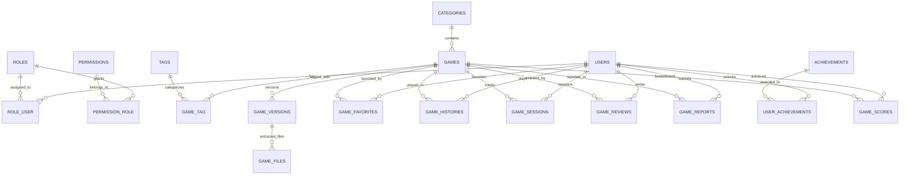

# 🗄️ DATABASE.md - Thiết Kế Cơ Sở Dữ Liệu & Sơ Đồ ERD (Chuẩn 3NF)

Hệ thống cơ sở dữ liệu **GameHub** được thiết kế trên **MySQL 8** tuân thủ chuẩn hóa 3NF, sử dụng đầy đủ khóa ngoại (`Foreign Keys`), chỉ mục (`Indexes`) và xóa mềm (`SoftDeletes`).

## 1. Sơ Đồ Thực Thể Liên Kết (Mermaid ERD)

## 2. Chi Tiết Các Nhóm Bảng Chính

### 2.1. Phân Hệ Xác Thực & Phân Quyền (Auth & RBAC)
- `users`: Lưu thông tin người chơi và quản trị viên (`id`, `name`, `email`, `password`, `avatar`, `bio`, `is_active`, `locked_at`, `total_points`).
- `roles`: Vai trò (`super-admin`, `admin`, `user`).
- `permissions`: Quyền hạn chi tiết theo chức năng.
- `role_user` & `permission_role`: Bảng trung gian liên kết nhiều-nhiều có ràng buộc khóa ngoại `CASCADE`.

### 2.2. Phân Hệ Trò Chơi & Phiên Bản (Core Game & Upload Center)
- `categories`: Danh mục game (`name`, `slug` unique, `icon`, `position`, `is_active`).
- `tags` & `game_tag`: Nhãn phân loại trò chơi.
- `games`: Bảng thông tin trò chơi chính (`title`, `slug` unique, `short_description`, `description`, `instructions`, `controls` JSON, `author`, `thumbnail_path`, `category_id`, `status`, `orientation`, `mobile_support`, `play_count`, `favorite_count`, `review_count`, `avg_rating`, `is_featured`, `current_version_id`, `deleted_at`).
- `game_versions`: Lưu từng phiên bản ZIP được tải lên (`game_id`, `version_number`, `storage_path`, `entry_point`, `file_size`, `extracted_size`, `file_count`, `manifest_data` JSON, `compatibility_report` JSON, `is_compatible`, `status`, `is_active`, `changelog`).
- `game_files`: Danh sách tệp tĩnh thuộc từng phiên bản (`game_version_id`, `file_path`, `type`, `mime_type`, `size`).

### 2.3. Phân Hệ Tương Tác, CMS & Gamification
- `game_favorites`: Lưu lượt yêu thích (unique theo `user_id` + `game_id`).
- `game_histories` & `game_sessions`: Theo dõi thời gian chơi và phiên chơi.
- `game_reviews`: Đánh giá 1-5 sao (unique 1 đánh giá trên mỗi cặp `user_id` + `game_id`).
- `game_reports`: Báo lỗi kỹ thuật hoặc báo cáo bình luận vi phạm.
- `banners`, `collections`, `collection_games`, `homepage_sections`, `settings`, `announcements`: Quản trị nội dung CMS động.
- `audit_logs`, `achievements`, `user_achievements`, `game_scores`: Nhật ký bảo mật và hệ thống điểm thưởng/bảng xếp hạng.

